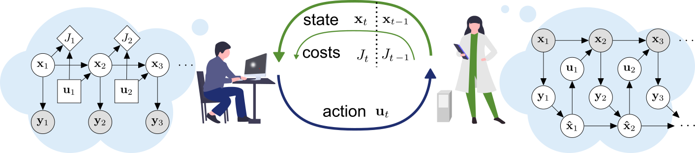

# LQG: Inverse Optimal Control for Continuous Psychophysics



<centering>

[](https://rothkopflab.github.io/lqg/)
[](https://pypi.org/project/lqg/)
[](https://doi.org/10.7554/eLife.76635)

</centering>

This repository contains the official [JAX](https://github.com/google/jax) implementation of the inverse optimal control method presented in the paper:

> [Straub, D., & Rothkopf, C. A. (2022). Putting perception into action with inverse optimal control for continuous psychophysics. eLife, 11, e76635.](https://elifesciences.org/articles/76635)

## Installation

The package can be installed via `pip`

```bash
python -m pip install lqg
```

Since publication of our [eLife paper](https://elifesciences.org/articles/76635), I have substantially updated the package. If you want to use the package as described in the paper, please install an older version `<0.2.0`:

```bash
python -m pip install lqg==0.1.9
```

If you want the latest development version, I recommend cloning the repository and installing it locally with [uv](https://docs.astral.sh/uv/):

```bash
git clone https://github.com/RothkopfLab/lqg.git
cd lqg
uv sync
```

This creates a virtual environment in `.venv` with the package and all development dependencies (including those for tests and documentation). You can run commands in it with `uv run`, e.g. `uv run pytest`. If you want to contribute, run `make install` instead of `uv sync`, which also installs the pre-commit hooks.

## Documentation

The [documentation](https://rothkopflab.github.io/lqg/) contains [tutorials](https://rothkopflab.github.io/lqg/tutorials/) that illustrate how to use the `lqg` package to define optimal control models, simulate trajectories, and infer parameters from observed data:

- [Overview](https://rothkopflab.github.io/lqg/tutorials/overview/) explains the model and its parameters, the extension to subjective internal models, and Bayesian inference of the parameters (based on [my tutorial at CCN 2022](https://www.youtube.com/watch?v=3DbO9n6_mNE)).
- [Data](https://rothkopflab.github.io/lqg/tutorials/data/) fits models to data from a tracking experiment ([Bonnen et al., 2015](https://jov.arvojournals.org/article.aspx?articleid=2301260)) with maximum likelihood estimation, compares them, and checks how well they reproduce the data.

Each tutorial is a Jupyter notebook, which you can find in [`docs/tutorials`](https://github.com/RothkopfLab/lqg/tree/main/docs/tutorials) and run locally.

## Citation

If you use our method or code in your research, please cite our paper:

```bibtex
@article{straub2022putting,
  title={Putting perception into action with inverse optimal control for continuous psychophysics},
  author={Straub, Dominik and Rothkopf, Constantin A},
  journal={eLife},
  volume={11},
  pages={e76635},
  year={2022},
  publisher={eLife Sciences Publications Limited}
}
```

## Extensions

### Signal-dependent noise

This implementation supports the basic LQG framework. For the extension to signal-dependent noise [(Todorov, 2005)](https://direct.mit.edu/neco/article-abstract/17/5/1084/6949/Stochastic-Optimal-Control-and-Estimation-Methods), please see [our NeurIPS 2021 paper](https://proceedings.neurips.cc/paper/2021/hash/4e55139e019a58e0084f194f758ffdea-Abstract.html) and [its implementation](https://github.com/RothkopfLab/inverse-optimal-control).

### Non-linear dynamics

We have recently extended this approach to non-linear dynamics and non-quadratic costs. Please check out our [NeurIPS 2023 paper](https://arxiv.org/abs/2303.16698) and [its implementation](https://github.com/RothkopfLab/nioc-neurips).
